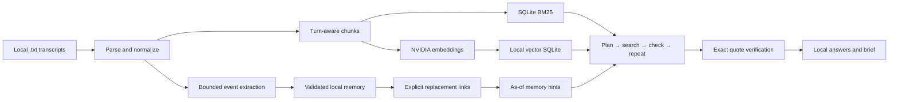

# Catalist Meeting RAG

A local Gradio interface and command line pipeline for searching meeting transcripts and answering questions with source citations. It parses transcript turns, makes overlapping chunks, indexes them with SQLite BM25, and can add NVIDIA embeddings for semantic or hybrid retrieval.

## Architecture



The transcript, indexes, memory records, caches, and outputs are local files. The NVIDIA API receives transcript windows for extraction or embeddings and retrieved excerpts for generated answers. Memory summaries focus the search; the final answer must still cite original transcript turns.

## Requirements

- Python 3.13 and `pip`.
- Meeting transcripts in the expected plain-text format for a real build.
- A NVIDIA API key for embeddings and generated answers. BM25 indexing and offline tests do not need a key.

The only third-party Python dependency is Gradio for the web UI. The CLI, indexing, and HTTP clients use the standard library.

## First-time setup (PowerShell)

Run these commands from the repository root:

```powershell
py -3.13 -m venv .venv
.\.venv\Scripts\python.exe -m pip install --upgrade pip
.\.venv\Scripts\python.exe -m pip install -r requirements.txt
Copy-Item .env.example .env
```

Edit the local `.env` and set `NVIDIA_API_KEY` to your own key. Keep the key out of terminal commands, screenshots, issues, and commits. Process environment variables override values in `.env`. The example file contains setting names and defaults only.

Place UTF-8 `.txt` files in `data/raw/transcripts/`. A file name should match its meeting ID, for example `ES2002a.txt`. The parser expects header lines such as `Meeting:`, `Team:`, `Meeting number:`, and `Speakers:`, followed by timestamped `Speaker A` turns. It stops the build and asks for review if a transcript is malformed or incomplete. The raw files are never modified.

## Build, chunk, and index

```powershell
# Parse transcripts, normalize search text, make chunks, and create the BM25 index.
.\.venv\Scripts\python.exe scripts/build.py

# Optional: use the existing chunks, rebuild BM25, then create/update embeddings.
.\.venv\Scripts\python.exe scripts/build.py --index-only --embeddings

# After adding or changing transcripts, skip unchanged parsing and update BM25.
.\.venv\Scripts\python.exe scripts/build.py --incremental

# Update only changed vector rows too (uses API quota for uncached chunks).
.\.venv\Scripts\python.exe scripts/build.py --incremental --embeddings
```

For a first build with embeddings, `scripts/build.py --embeddings` performs both commands in one pass. `--index-only` requires existing chunk files. Run the plain build again when you add or change transcripts; then run the embedding command if you use semantic or hybrid retrieval. Re-running embeddings reuses matching vectors in the local cache and requests only uncached text. Embedding calls use API quota.

Chunking happens inside `scripts/build.py`: each parsed meeting is saved in `data/parsed/` and divided into speaker-turn-aware chunks in `data/processed/chunks/`. Defaults in `app/config.py` are a 400-token target, 500-token maximum, and 50-token overlap. Change `CHUNK_TARGET`, `CHUNK_MAXIMUM`, and `CHUNK_OVERLAP` there, then rerun the plain build and the embedding build. Preserve enough overlap to retain context at boundaries. The BM25 and vector indexes are built from the chunks; no separate chunk command is required.

### Build decision and action memory

```powershell
# Show the number of bounded extraction windows without making API calls.
.\.venv\Scripts\python.exe scripts/build_memory.py

# Start with one meeting, then build the full local event store.
.\.venv\Scripts\python.exe scripts/build_memory.py --meeting TS3012a --run
.\.venv\Scripts\python.exe scripts/build_memory.py --run --no-reconcile --model nvidia/nemotron-3.5-lightning-30b-a3b --fallback-model nvidia/nemotron-3.5-bolt-e4b

# Once every meeting has a saved file, link explicit later replacements.
.\.venv\Scripts\python.exe scripts/build_memory.py --run --reconcile-only --model nvidia/nemotron-3.5-lightning-30b-a3b
```

Extraction checks each proposed event and exact quote against its source turn. Code supplies source identities and unambiguous contract defaults; ambiguous missing status or evidence is repaired once by the model or rejected and counted. An optional fallback model is used for empty or heavily rejected windows. A malformed long response is retried on smaller, source-turn-bounded windows. Per-meeting files in `data/processed/memory/` are reused when the transcript, model settings, prompt version, and window size match; `--retry-rejected` deliberately re-extracts files with rejected records and retains the previous file if the new result is worse. Use `--reconcile-only` to link all saved complete teams without rerunning extraction. Reconciliation asks whether a later related event explicitly replaces an earlier one, then validates each link. As-of views derive the current status at a meeting cutoff. This stage sends transcript text to NVIDIA and can make hundreds of calls; review the dry-run count and your quota first. Use `--team`, `--meeting`, or `--max-meetings` for a bounded run, and `--no-reconcile` to extract without linking.

## Configure models

Set these values in the local `.env`:

| Setting | Purpose |
| --- | --- |
| `NVIDIA_API_KEY` | Used for generation and embeddings. |
| `EMBEDDING_MODEL` | Currently only `nvidia/nemotron-3.5-embed-8b` is supported by the adapter. |
| `EMBEDDING_DIMENSIONS` | Vector size, default 4096. Rebuild the vector index if changed. |
| `EMBEDDING_BATCH_SIZE` | Number of passages sent per embedding request, default 16. |
| `GENERATION_MODEL` | Exact NVIDIA model ID for answering questions. |
| `GENERATION_MAX_TOKENS` | Maximum generated tokens, default 2048. |
| `*_REQUESTS_PER_MINUTE`, `*_TIMEOUT`, `*_MAX_RETRIES` | Separate embedding and generation request limits; see `.env.example`. |

The generation model may be changed in `.env`, in the UI, or for one CLI run with `--generation-model`. Model availability and quota can change. With a configured key, list current candidates and probe a selected generation model:

```powershell
.\.venv\Scripts\python.exe scripts/models.py --provider nvidia
.\.venv\Scripts\python.exe scripts/models.py --provider nvidia --probe <exact-model-id>
.\.venv\Scripts\python.exe scripts/run.py --check-generation
```

A successful probe checks basic JSON generation; check answer quality with your own questions. The embedding adapter rejects another embedding model ID. If you change embedding dimensions, rebuild embeddings before using `embedding` or `hybrid` search.

## Run the app and scripts

```powershell
# Local web UI; open the address printed in the terminal, usually http://127.0.0.1:7860.
.\.venv\Scripts\python.exe app.py

# One question. Use a team ID such as ES2002 or ALL for all teams.
.\.venv\Scripts\python.exe scripts/run.py --question "What power source did the team choose?" --team ES2002 --method hybrid

# Keyword retrieval needs no embedding index or embedding calls, but answers still use NVIDIA.
.\.venv\Scripts\python.exe scripts/run.py --question "What power source did the team choose?" --team ES2002 --method bm25
```

`--method` accepts `bm25`, `embedding`, or `hybrid`. `--as-of a|b|c|d` limits the latest meeting considered; `--limit` controls the number of retrieved chunks. The UI expects indexes already built and does not build them itself.

Optional local evaluation and submission commands require question files that are intentionally not in GitHub:

```powershell
.\.venv\Scripts\python.exe scripts/evaluate.py --method bm25 --questions evaluation/my_questions.json
.\.venv\Scripts\python.exe scripts/evaluate_answers.py
.\.venv\Scripts\python.exe scripts/evaluate_answers.py --run --method hybrid
.\.venv\Scripts\python.exe scripts/test_rag.py --id 1 --method bm25 --no-judge
.\.venv\Scripts\python.exe scripts/submit.py --questions tests/questions.json --method hybrid
```

The submission script expects a local JSON object with a `questions` array. Each item contains `question_id`, `team`, and `question`. `scripts/test_rag.py` uses `tests/rag_test_questions.json` for its development benchmark. These files remain on the machine that owns the data. Submission output goes to `outputs/answers.json`; detailed runs and reports also stay local.

## Where data is stored

| Local path | Contents |
| --- | --- |
| `data/raw/transcripts/` | Original input documents. |
| `data/parsed/` | Parsed turns and source text. |
| `data/processed/chunks/` | Chunk JSON, including source excerpts. |
| `data/processed/bm25.sqlite3` | Keyword index. |
| `data/processed/vectors.sqlite3` | Normalized embedding vectors and chunk payloads. |
| `data/processed/memory/` | Validated per-meeting events and per-team replacement links. |
| `data/cache/embeddings.sqlite3` | Resumable embedding cache. |
| `data/cache/generation.sqlite3` | Generation response cache. |
| `data/processed/*.jsonl`, `data/processed/build.log` | Usage logs and build log. |
| `evaluation/`, `outputs/`, `tests/*.json` | Local question sets, reports, and answers. |

`scripts/evaluate_answers.py` scores the ten locally checked questions separately from retrieval. It uses the checked answers only after the agent run, saves details in `data/processed/evaluation_runs/`, and writes `evaluation/answer_results.md`. Model verdicts still require human comparison with the transcripts. The script is a dry run unless `--run` is supplied.

These paths, `.env`, `docs/`, the assignment PDF, `guideline.md`, and common document/transcript file extensions are ignored by Git. Only `data/.gitkeep` is committed to retain the folder. To preserve an index between computers, copy the relevant `data/` files through your own private local transfer or rebuild from your transcripts. Keep the BM25 index, vector index, and embedding settings in sync; a changed corpus or vector configuration requires rebuilding the vector index. The embedding cache can speed up rebuilding but is optional.

**Privacy note:** The UI binds to `127.0.0.1` by default, disables Gradio analytics, and does not create a public share link. Storage is local, but the NVIDIA embedding API receives chunk text when generating embeddings, and generation receives retrieved source text and questions. `bm25` indexing and retrieval are local; generated answers still call the API. If your documents must never leave the computer, use only local BM25 indexing/retrieval and do not run embedding, generation, UI question answering, or model probe commands until those API integrations are replaced.

## Measured build and evaluation

The local corpus has 138 meetings and produces 3,448 chunks with the current settings. A prior full embedding run used 216 successful batches and about 23 minutes 20 seconds. Scaling that measured run linearly to 1,000 meetings gives about 24,986 chunks, 1,565 embedding batches, and 2 hours 49 minutes, subject to network latency and provider quota. The current memory window rule yields 415 extraction windows for 138 meetings, or about 3,007 for 1,000, before any retries or reconciliation. At a 10 request/minute limit, extraction pacing alone has a minimum of about five hours at that scale. Actual paid cost depends on the selected provider's current input/output token rates; the local `data/processed/*_usage.jsonl` files record measured tokens without logging prompts or keys.

A previous 20-question agent run scored 65% under a provisional model judge (12 correct, 2 partial, 5 unanswered, 1 error). A separate BM25 top-five retrieval run over ten checked questions found at least one expected source for 8/10 and all expected sources for 4/10, with no team or cutoff violations. The exact-quote verifier accepted the local 25-answer submission and its cited brief; that verifies provenance and format, not hidden-answer correctness. The ten-question end-to-end evaluator above is separate from the retrieval-only report, and its verdicts need human source review. Three observed failure modes were a required role citation omitted from a draft, a multi-part materials answer missing constraints, and a malformed generation response rejected by the schema check. The current safeguards retain checked citations, search again for missing facts, and fail explicitly when a response cannot be validated.

## Verify and publish safely

```powershell
.\.venv\Scripts\python.exe -B -m unittest discover -s tests/unit -v
.\.venv\Scripts\python.exe scripts/verify_submission.py
git status --short
git ls-files
git check-ignore -v .env data/raw/transcripts/ES2002a.txt data/processed/vectors.sqlite3 docs/private.pdf outputs/answers.json
```

`verify_submission.py` checks all answer IDs, citation counts, team scope, brief sections, and each quote against one original local speaker turn. It uses no API calls and does not judge whether the quoted evidence proves the answer.

The new GitHub repository should receive a **fresh root commit**. Older local history tracked `.env` and cache files, so do not push an old branch or its history. Before pushing, inspect the staged file list and confirm it contains code, tests, `.env.example`, `.gitignore`, `requirements.txt`, `README.md`, and `data/.gitkeep` only. Never use `git add -f` for ignored files. If a real key was ever pushed to the previous remote, rotate it with the provider.

This repository is published at [catalist_agent](https://github.com/skr2rathishan-oss/catalist_agent). For subsequent changes, review staged files and push `main`:

```powershell
git status --short
git diff --cached --name-only
git push origin main
```

If you make a separate clean copy without an `origin`, add `https://github.com/skr2rathishan-oss/catalist_agent.git` with `git remote add origin <url>` first. Keep `space` or any other deployment remote out of this push workflow unless you explicitly intend to publish there; a deployment can expose data or require separate storage and secret configuration.
